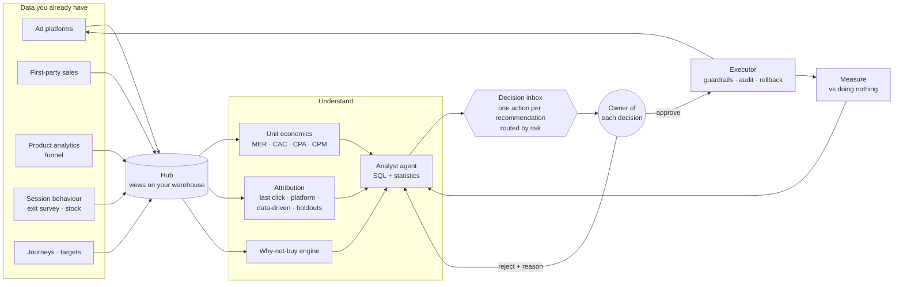

# Growth OS

**A decision-and-action layer for marketing, on top of the data you already have.**

## Start here

**What it is.** A team of Claude agents reads a 12-market consumer brand's data (sales, eight paid channels, organic,
customer comments, real weather and holidays), proposes decisions with the money at stake, routes each one to the role
that owns it, and executes only what that person approves: four eyes on risky changes, budget caps, a kill switch, an
audit log and rollback.

**Look (no API key, about 3 minutes).** Open the [live console](https://djcrafted.com/growth-os/), or build it locally
from the committed reports:

```bash
uv venv --python 3.12 && uv pip install -e .
growth-os console          # writes dist/console/index.html; no hubs needed, no model calls
```

Open `dist/console/index.html` over a local server (`python3 -m http.server --directory dist/console`), go to
**Agent team → Decisions** and approve or reject the AI's 12 decisions. The panel shows the simulated quarter for your
choice: measured runs where they exist (everything approved, everything rejected, one rejected, one approved), a
labelled sum of single runs otherwise.

**How to read the numbers.** The fairer read is the held-out eval: on three businesses the agents never saw, the team
passed 37 of 45 graded checks and gross profit rose 2.7%, 4.6% and 3.9% in the simulated quarter. That score was measured
while seeds 301–303 were private; publishing this repo makes them public, so future held-out claims need new seeds. The
showcase business (seed 7) shows +€1.32M gross profit, 3.9% of the quarter's gross profit. Its situations were planted on
purpose, so that is an upper bound for a business built to contain them. Every figure is labelled:

| Label | Means | Example |
|---|---|---|
| Measured | Counted from a saved run or eval file | $2.26 and 5 minutes for one team run |
| Simulated | Produced by the synthetic business, against the team's usual process | +€1.32M gross profit in the quarter |
| Estimate | Stated assumptions, to be replaced with a real team's numbers | ~53 hours of team work a week |

**Where it is wrong.** The same failures the case study lists:

| Miss | Seen in |
|---|---|
| The mix model overestimates marginal returns (r = 0.59 against the simulation's truth) and misses Meta prospecting saturation | showcase and held-out runs |
| The team sometimes dismisses a real demand gap as long-standing | held-out runs |
| A search-traffic drop hidden by extra paid spend was missed in two of three held-out businesses | held-out runs |
| One budget cut in a market that only had noise (model fit r² 0.53) | one held-out run |
| Leaving out decision #04 (bring London back to budget) earns €20,141 more than the AI's plan | showcase leave-one-out runs |

**Check it yourself.**

```bash
pytest -q                                                   # no API calls; set REQUIRE_NODE=1 to require the Node deck tests
node --test tests/deck.test.mjs                             # the deck's state rules, directly (Node 20+)
python -m growth_os.enterprise.prepare state/enterprise-7.sqlite 7      # the synthetic hub (cached comment labels, no key)
python -m growth_os.enterprise.outcomes --leave-one-out --seed 7       # 10 quarter simulations, ~2 minutes, no key
growth-os console                                           # rebuild from the hubs; refreshes reports/console-data-7.json
```

Rerunning the agents needs `ANTHROPIC_API_KEY` in your environment:

```bash
growth-os team --hub state/enterprise-7.sqlite              # the agent team: about $2.30 and 5 minutes
python -m growth_os.enterprise.outcomes state/enterprise-7.sqlite reports/team-enterprise-7.json reports/outcomes-enterprise-7.json
python evals/team_eval.py --seeds 301 302 303 --split heldout           # graded eval: about $2.50 per seed
```

Each simulation works in its own folder under `state/sim` and removes it when it ends, even after an error; it needs
about five copies of the 160 MB hub free. Errors print a code and the fix ([docs/errors.md](docs/errors.md)).
Prerequisites: Python 3.12, [uv](https://docs.astral.sh/uv/), Node 20+ for the deck tests.

**Ask it from Claude (MCP).** After `prepare`, add the read-only server to Claude Desktop's config:

```json
{"mcpServers": {"growth-os": {"command": "growth-os-mcp", "args": ["--hub", "/path/to/growth-os/state/enterprise-7.sqlite"]}}}
```

It serves `describe_hub`, `query`, `compare_rates`, `list_engines` and `run_engine`: the same engines the agents call.

**Why its own budget model, not Meridian or Robyn.** The agents need response curves per market × line × channel,
refitted inside the hub every week and queryable as marginal ROAS in one tool call. A pooled log-log model with
shrinkage does that in seconds. The cost is weaker priors and no Bayesian uncertainty, which shows in the 0.59
correlation above. Comparing it against Meridian on the same synthetic history is the obvious next test.

Questions or problems: open an issue.

## The problem

Most marketing organisations have solved *consolidation*. Ads, web analytics and CRM land in one warehouse, and dashboards sit on top. What they haven't solved is the step from data to decision:

| What exists | What's still broken |
|---|---|
| A warehouse | Data is unified, but **insight still waits for someone to look**. Dashboards are pulled, not pushed |
| Dashboards | They show *what* changed, not *whether it's real*. Noise gets acted on and real shifts get missed |
| Analysts | Their time goes to the top markets and brands. **The long tail of segments is never analysed** |
| Ad-platform automation | It optimises for the platform's goal (clicks, its own conversions), not qualified pipeline or revenue |
| Structured data | Reviews, forum posts, call notes and tickets mostly never reach the warehouse, so **what customers say isn't counted** |
| AI pilots | Most stall as demos because governance, evaluation and cost were never solved |

## The solution: a decision loop, not another dashboard

Growth OS sits on the data a company already has and runs the part of the week that dashboards leave to people:

1. **Reads everything** into one hub: ad platforms, first-party sales, a product-analytics funnel (Mixpanel-style),
   session behaviour (rage and dead clicks), an exit survey ("what stopped you buying?"), stock and capacity, customer
   journeys, and the team's targets.
2. **Finds what matters.** An analyst agent (Claude) queries the hub, tests every claim, corrects for the number of
   segments it scanned, checks last year before calling a drop, and sizes each finding in money.
3. **Proposes an action, not an insight.** Every recommendation carries one action from a fixed
   [catalogue](docs/decision-layer.md): pause or rotate an ad, change or shift budget, start an email flow, open a
   ticket for engineering or ops, launch an A/B test, notify a stakeholder. Targets that do not exist are sent back.
4. **Routes it** by risk to the role that owns it (paid media, CRM, product, growth manager, leadership), in Slack or the
   console, with reminders and escalation, and a brief per role in that role's terms.
5. **Runs it on approval**, inside guardrails: kill switch, approver roles checked against the team table, four eyes on
   risky actions, budget caps, audit log, rollback. A rejection needs a reason; the next memo reads it.
6. **Measures it** on the recommendation's own metric, in gross profit after marketing, and, in the simulation,
   against an identical world where nothing was done.



### The questions it answers, by role

| Role | Question | Where |
|---|---|---|
| Leadership | Are we on plan (MER, marketing as a share of gross revenue, CAC payback)? Where is money leaking? What needs my sign-off? | Leadership brief, high-risk approvals |
| Growth / marketing manager | What should we do this week, who owns it, and did last week's decisions work? | Decision inbox, tracker, follow-up |
| Paid media manager | Which ads miss CPA, ROAS or CPM targets, which creatives are fatigued, and is platform ROAS real? | Channel brief, attribution |
| CRM / lifecycle manager | Which products need a push before they end? | CRM brief, email-flow actions |
| Product / engineering owner | Where does the site lose buyers, and what does it cost? | Why-not-buy engine, tickets |
| Finance | Spend against budget, MER, CAC and payback, budget changes approved | Finance brief |
| Workflow / automation manager | Is every decision routed, approved by the right person, executed, logged and reversible? | Executor, audit log, Slack endpoint, MCP |

## Evidence

Three kinds, each one stated for what it does and doesn't prove.

**The agent team against simpler setups (held-out, 3 November 2026).** On the three businesses the team never saw, the team passed
37/45 checks, one Claude call given every tool's output passed 35/45, and a fixed rules checklist with no model passed 39/45. Their
simulated gross-profit gains overlap (+2.7% to +4.6%). The team does not beat the simpler setups on this benchmark: the shared engines
and the approval loop do most of the work. A person re-graded the team's 45 checks: 41 passed against the AI grader's 37 (82%
agreement, kappa 0.24). Details, and what this does and does not show: [docs/baselines.md](docs/baselines.md).

**1. Graded against known answers, including held-out data.** Synthetic data with problems planted on purpose; a separate grader scores each memo against the answer key (`evals/analyst_eval.py`).

**The headline scenario** is a consumer brand selling time-limited products online in **12 cities**, with Meta, Google and TikTok plus email, organic and direct: 60 weeks of daily data, so every number can be read against last year. Seven situations a multi-city growth team meets are planted, and two traps where the right answer is to stay quiet:

| Planted | What it tests |
|---|---|
| A Meta video wearing out in one city (frequency up, clicks down) | Drilling from city to creative |
| Brand search "earning" revenue that mostly comes anyway, proven by a two-week pause | Incrementality, not platform ROAS |
| iOS checkout failing in two cities | Finding a product bug from marketing data |
| A new city ramping slower than earlier launches | Comparing like with like |
| Email growth hiding a paid decline | Channel mix |
| A time-limited product falling behind its selling window | Pacing, money at stake |
| A city spending its monthly budget too fast | Pacing |
| **Trap:** a city that dips every year at this time | Year-over-year before alarm |
| **Trap:** a large swing on a tiny base | No false alarms |

**Protocol.**
1. Develop on seeds 1–2 only: 25/28, then 27/28.
2. Freeze the analyst at a tagged commit (`analyst-frozen-b2c`).
3. Run once on five seeds it has never seen.

| Held-out (frozen analyst, seeds 101–105, run once) | Result |
|---|---|
| Criteria passed | **68/70 (97%)** |
| False alarms in noise-only cities | 0 of 5 |
| Numbers in memos that trace to the data (automatic check) | 96.6–99.3% per memo |
| Recommendations with a working metric to check the outcome | 26/26 |
| Cost per memo (claude-opus-5-5, prompt caching) | ~0.90 USD |

**Known weakness:** new-market launches. On 2 of 5 held-out seeds it missed that the new city is behind earlier launches, and once called it "on track". The next fix is a precomputed launch index. It has to be judged on fresh held-out seeds, because these five are spent.

| Scenario | What it tests | Result | Cost per memo |
|---|---|---|---|
| Single business, 6 weeks | Five planted patterns, including a "winning" page with too small a sample to mean anything | **24/24** criteria over 3 seeds | ~0.60 USD |
| B2C, 12 cities (above), held-out | Seven situations, two traps, money at stake | **68/70** on 5 unseen seeds | ~0.90 USD |
| Enterprise: 10 markets, 26 weeks, ~196k sessions, ~13k leads | Three problems hidden in single markets, a small-sample trap, and **no false alarms in six noise-only markets** | **24/24** over 3 seeds (first version: 21/24, see below) | ~1.45 USD |

The first enterprise run across three seeds scored 21/24. Across 10 markets, some move by chance, and the analyst twice reported such a swing as a real change ("Portugal improved"); once it saw Germany dip without tracing it to the one failing ad. Two fixes followed. The statistics tool now corrects for how many segments were scanned (Bonferroni), and the brief now includes each ad's results inside each market. Then it scored 24/24 on the same seeds. Both runs are kept in `evals/results/` and in the console's evaluation history.

**Full eval history.** Every run is kept in `evals/results/`; nothing is dropped.

| When | Scenario | Seeds | Passed | What happened |
|---|---|---|---|---|
| 2026-10-30 11:07 | small | 11 | 7/8 | Missed slow follow-up on seed 11: the brief had no contact-speed breakdown, which was then added |
| 2026-10-30 11:11 | small | 11, 23 | 15/16 | Seed 23 'failure' was a wrong answer key (the pattern wasn't in that seed's data); generator fixed |
| 2026-10-30 11:17 | small | 7, 23, 31 | 24/24 | Final small-scenario run, on seeds 7, 23, 31 |
| 2026-10-30 12:11 | enterprise | 7 | 8/8 | Enterprise, first run |
| 2026-10-30 12:16 | enterprise | 23, 31 | 13/16 | False alarms in noise-only markets (seeds 23, 31) and a missed ad-level cause (23) |
| 2026-10-30 12:23 | enterprise | 7, 23, 31 | 24/24 | After the multiple-comparisons correction and the ads-by-market brief; same seeds, so not independent |

**Caveats, stated plainly:**
- The fixes were scored on the seeds they were made for, so the final scores aren't independent evidence.
- The grader is the same model family as the analyst.
- Held-out evaluation, a check of the grader against a person, and simpler baselines are in [docs/baselines.md](docs/baselines.md).

**2. Real public data, checked against source.** The analyst was run, unchanged, on public datasets. Its key figures were then recomputed from the raw files with separate code, and every one matched ([docs/cases](docs/cases/README.md)).

| Data | What the analyst found |
|---|---|
| Olist B2B funnel: 8,000 leads, 495 landing pages, 842 deals | The 30-day close rate fell from 10.9% (April) to 7.0% (May), p=0.0005, starting in the second half of April and across every channel, while several sales reps stopped appearing on won deals: a sales-coverage problem, not lead quality. 361 of 495 landing pages never produced a deal |
| 1,143 Facebook ads | 20.4% of all spend went to one segment at 137.76 per buyer, against 30.77 in the best. It also flagged an attribution flaw nobody asked about: 207 zero-spend ads credited with 76 buyers |
| 3,000 customer reviews, joined to the funnel | Classified into themes for 0.07 USD. Merchants acquired through search have happier customers than the baseline (21.7% negative against 30.3%, p=0.0005). It also rejected the hypothesis I expected it to confirm, because I'd picked the wrong baseline ([details](docs/cases/README.md#a-hypothesis-the-analyst-didnt-confirm)) |

**AI visibility, live run (October 2026).** 15 answers from Claude with web search to five unbranded questions Brazilian sellers ask. Olist made the shortlist in 12 of 15 (80%, 95% range 55–93%) but was **never named first**: average position 6.7, behind Mercado Livre, Shopee and Bling. Its own site was never a source; the answers drew on third-party blogs and comparison posts. Discovery also surfaced competitors missing from the tracked list (UpSeller, TikTok Shop). Cost: 1.33 USD.

**3. Live pilot.** Running on a small web studio's real Meta ads, website and pipeline since 30 October 2026. Live results will be added once there are weeks of data. They will be small, real, and labelled as such.

## Console

Live demo: **https://djcrafted.com/growth-os/** · `growth-os console` builds it from the hubs, memos, loop results and
eval history: one static page, CSP-clean, no server, no tracking, light and dark.

It opens on the **decision inbox**: each recommendation with its action, risk, approving role and rollback. Approve one
and it shows the guardrails passing, what was executed, and the outcome against doing nothing (revenue, spend, gross
profit, its own metric, and a with/without chart). Reject one and it asks for a reason and shows what doing nothing
costs. Below: a brief per role, the why-not-buy causes, unit economics against targets, the attribution lenses with a
holdout plan, and every assumption the simulation makes. Outcomes in the public demo are precomputed by the simulation.

## Modules

Every module answers the same questions: problem, decision, KPI, evidence.

| Module | Problem it solves | Decision it enables | KPI it moves | Status |
|---|---|---|---|---|
| **Data hub** | Agents need one consistent view | One set of numbers for people and agents | Hours spent assembling reports | ✅ Running on the pilot since 30 Oct 2026 |
| **Decision inbox and executor** | Insight is not action: changes wait for meetings and get lost between tools | Approve or reject in one place; approved actions run inside guardrails | Time from data to change; share of decisions executed and measured | ✅ Built: catalogue, roles, four eyes, kill switch, audit, rollback, Slack endpoint ([details](docs/decision-layer.md)) |
| **Simulated market** | You cannot see what a decision was worth | Each decision run forward with and without it | Revenue and gross profit vs doing nothing | ✅ Built (synthetic; assumptions stated) |
| **Unit economics** | CPM, CPA, ROAS, MER and CAC live in different tools against no target | Which markets and ads miss target, by how much | MER; blended CAC; payback | ✅ Built |
| **Attribution** | Last click, platforms and analytics each claim the same sale | Which channels add revenue, and which holdout settles it | Spend on channels that add little | ✅ Built: last click vs platform vs Markov vs natural experiments, geo-holdout planner |
| **Why-not-buy engine** | Visitors leave and nobody knows why | Fix the cause: payment, capacity, price, trust | Revenue lost per cause | ✅ Built: funnel, session behaviour, exit survey, stock |
| **Stakeholder briefs** | One report fits nobody | Each role sees its own numbers and its pending decisions | Approval time; overdue decisions | ✅ Built: six role briefs, reminders, escalation |
| **Conversion tracking** (cookieless) | Leads can't be tied to ads without cookies or a pixel | Which ad brought which qualified lead | Share of leads attributed | ✅ Running on the pilot since 30 Oct 2026 |
| **Ads agent** | Budget keeps flowing to ads that stopped working | Pause losing ads, sooner and every time | Spend on ads breaking the rules; cost per qualified lead | ✅ Running on the pilot, propose-and-approve; no ad judged yet |
| **Analyst** | Insight waits for someone to look; long-tail segments are never analysed | What to fix, stop, scale or test, ranked | Decision latency; segments analysed per week | ✅ Built, evaluated, case studies |
| **Automated reporting** | Five dashboards, nobody reads them | One message on Monday with decisions in it | Time from data to decision | ✅ Running on the pilot; first memo 2 Nov 2026 |
| **Listening** | What customers say never reaches the warehouse | Which complaints are growing, and where | Complaint themes caught before they hit close rate or ratings | ✅ Built, real-data case |
| **Recommendation tracker** | Insight is rarely followed up, so nobody knows which recommendations worked | Which actions were taken, and whether their metric moved | Insight-to-action rate; share of actions that worked | ✅ Built: every recommendation stores a re-runnable metric query and its baseline; `growth-os followup` judges the outcome |
| **Slack approvals and MCP access** | Decisions happen in chat, not in dashboards | Approve or reject where the team already works; ask the hub questions from Claude | Time from memo to decision | ✅ Built: Slack Block Kit messages; read-only MCP server (`growth-os-mcp`) |
| Landing pages matched to ads | One page for every ad and audience | Which page wins, called only on enough data | Lead rate per page | 🟡 Designed |
| AI video ads | Creative judged on clicks, not on outcomes | Which creative brings qualified leads | Cost per qualified lead by creative | 🟡 Pipeline exists outside Growth OS |
| Behaviour-triggered follow-up | Slow follow-up loses leads (found in both eval and real data) | Who to contact now | Speed to lead; qualified rate | 🟡 Insight built, action not yet |
| Competitor ads | Competitors' working ads are public but unread | What angles to test next | Hit rate of new creative | ⬜ Planned (Meta Ad Library) |
| **AI visibility** | Buyers ask assistants, not search, and nothing tracks whether you're recommended | Where the brand is missing or ranked low in AI answers, and which sites shape them | Mention rate and rank on unbranded questions | ✅ Built, real run ([details](docs/ai-visibility.md)) |
| Programmatic SEO | Long-tail demand unserved | Which pages to build from open data | Organic leads per page | ⬜ Planned |
| Creator discovery | Creator programmes picked by follower count | Who already talks about the problem | Leads per creator | ⬜ Planned, built on listening |

## Impact at enterprise scale

| KPI | Why it matters | How Growth OS moves it |
|---|---|---|
| **Decision latency** (data lands → change made) | Every week of delay is budget on the wrong thing | Agents push ranked findings the day the data lands |
| **Segment coverage** | Problems hide in the long tail | Every market, brand and channel analysed every period, for about 1–2 USD per memo |
| **Insight-to-action rate** | Insight nobody acts on is worth nothing | Each recommendation comes with an owner action, expected impact and a metric to check |
| **Spend stopped on losing ads** | Direct, attributable savings | Rule-based proposals with an audit trail |
| **False-alarm rate** | Teams stop trusting tools that cry wolf | Statistics before claims; graded on noise-only segments |

How to roll this out, phase by phase, with exit criteria: [docs/deployment-playbook.md](docs/deployment-playbook.md).

## Governance by design

- **Propose, then act only on approval.** Every action comes from a fixed catalogue with a risk tier, an approving role, limits and a rollback. Approvals are checked against the team table; risky ones need a second person; a kill switch stops everything. The live pilot account can only pause or resume ads.
- **Guards before rules.** No judgement during an ad's learning phase, and never a proposal that leaves a campaign empty.
- **Personal data stays out.** The analyst and ads agent see aggregates only. The listening classifier reads customer text after contact details are stripped, and stores labels and paraphrases, never the text ([governance](docs/governance.md)).
- **Traceable.** Every proposal, approval, sync and memo is logged, and every memo keeps the queries and statistical checks behind its numbers.

Details: [governance](docs/governance.md) · [architecture](docs/architecture.md) · [listening](docs/listening.md) · [website contract](docs/site-endpoint.md)

## Try it

```bash
uv venv --python 3.12 && uv pip install -e . pytest
pytest -q                                                    # 63 tests (2 need Node), no API calls
python -m growth_os.showcase state/showcase-7.sqlite 7       # synthetic 12-city business with behaviour data
growth-os analyse --hub state/showcase-7.sqlite --period-days 28 --name memo-showcase-7   # needs Claude credentials
growth-os loop --hub state/showcase-7.sqlite --memo reports/memo-showcase-7.json --out reports/loop-showcase-7.json
growth-os inbox --hub state/showcase-7.sqlite                # decisions waiting, by role
growth-os briefs --hub state/showcase-7.sqlite               # one brief per role
python -m growth_os.demo_b2c                                 # synthetic 12-city B2C hub
python -m growth_os.demo_enterprise                          # synthetic 10-market hub
growth-os console                                            # dist/console/index.html
growth-os analyse --hub state/enterprise-hub.sqlite --period-days 28    # needs Claude credentials
python evals/analyst_eval.py --scenario b2c --split heldout --seeds 101  # graded, ~1 USD per seed
growth-os-mcp --hub state/b2c-hub.sqlite                     # the hub as a read-only MCP server
```

Real public data: download the Kaggle datasets listed in [docs/cases](docs/cases/README.md), then run `growth-os load …`, `growth-os listen …` and `growth-os analyse …` as shown there.

## Run it for real

1. `cp config.example.toml config.toml`, then set the target cost per lead and the analyst's business context.
2. `cp .env.example .env`, then add an ad-platform token, the account ID and the website endpoint.
3. Tag ads with `utm_content={{ad.id}}`, and schedule `check` (hourly), `sync` (daily) and `report` (weekly) from `launchd/`.

## Licence and credits

MIT. Case studies use the Olist marketing funnel and Brazilian e-commerce datasets (Kaggle, CC BY-NC-SA 4.0) and the "Sales conversion optimization" dataset (Kaggle). Raw data is not redistributed.
