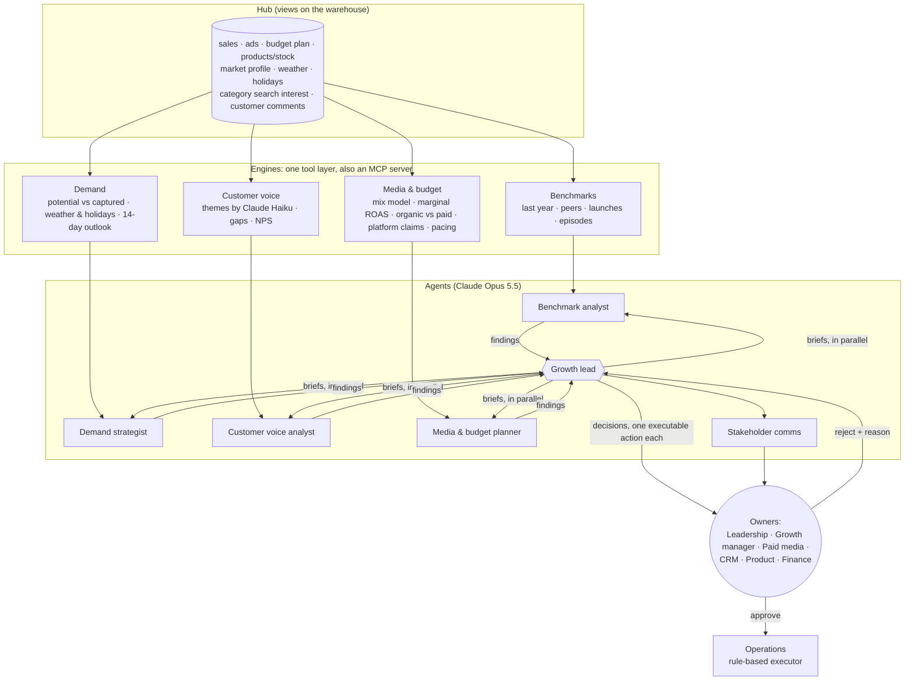

# The agent team

Growth OS runs as a team of AI agents with dedicated roles. They share one tool layer (the engines below), which is also
served over MCP, so a person can ask the same questions from Claude Desktop or Claude Code that the agents ask.

| Agent | Job | Tools | Output |
|---|---|---|---|
| Growth lead | Briefs the specialists, joins and ranks their findings, decides | ask_* (specialists, run in parallel), run_sql | Decision memo: each recommendation is one catalogue action with a target, an owner, a metric to check it |
| Benchmark analyst | Where each market departs from its own history, its peers and earlier launches | benchmark, scan_benchmarks, past_episodes, run_sql, compare_rates | Gaps with benchmark and range; what is *not* a problem |
| Demand strategist | Demand the brand is not capturing, and what weather and holidays will do next | demand_potential, weather_sensitivity, demand_outlook, demand_model_accuracy, line_marginal_returns | Demand gaps in money, sensitivities with ranges, 14-day outlook, model accuracy |
| Customer voice analyst | What customers say, and where it explains a symptom | voc_gaps, voc_examples, nps_by_market, benchmark | Themes over-represented by market and line, new vs before |
| Media & budget planner | Where money works | channel_response, reallocation_plan, line_marginal_returns, organic_vs_paid, platform_vs_first_party, budget_pacing | Saturated and under-funded channels, over-claiming channels, moves with expected gain |
| Stakeholder comms | Tells each role what changed and what they must decide | (none: decisions + computed facts) | One message per role |
| Operations | Executes approved actions | the executor (not a model) | Changes in the ad account / tickets / rules, audit log, rollback |

## How it runs

- One command: `growth-os team --hub <hub>`; schedule it weekly (launchd/cron, or a Managed Agents scheduled
  deployment). Each run saves every agent's turns, tool calls, transcript, cost and time.
- **Cost cap:** a run stops cleanly when its total spend reaches the cap (default 10 USD).
- **Specialists run in parallel**; the lead waits for all four before deciding.
- **Validation before anyone sees it:** a decision whose target does not exist is sent back to the lead with the errors.
- **Routing:** each decision goes to the role that owns its risk tier (see [decision-layer.md](decision-layer.md)).

## What is AI and what is not

| Part | What it is | Why |
|---|---|---|
| Engines (benchmarks, demand, mix, voice gaps) | Deterministic statistics, tested | The same numbers every time, checkable, cheap |
| Customer comment labels | Claude Haiku 5.5 (Batch API) | Understanding text in six languages |
| Specialists, growth lead, comms | Claude Opus 5.5 agents | Choosing what to look at, joining evidence across sources, judging what is noise, deciding, explaining |
| Operations | Rules | Nothing runs that was not approved |

## MCP

`growth-os-mcp --hub <hub>` serves `describe_hub`, `query`, `compare_rates`, `list_engines` and `run_engine`, all
read-only. The engines are the same functions the agents call.
